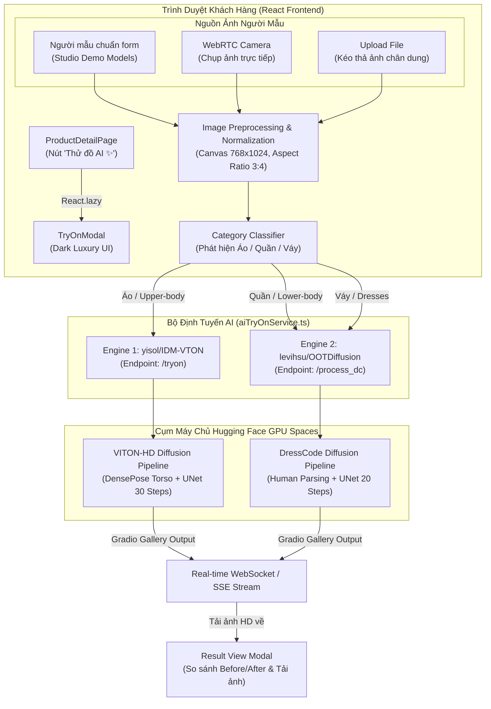

# TÀI LIỆU KỸ THUẬT CHI TIẾT: HỆ THỐNG PHÒNG THỬ ĐỒ ẢO AI (AI VIRTUAL TRY-ON STUDIO)

> **Dự án**: Website Thời Trang Cao Cấp (Fashion E-Commerce)  
> **Phiên bản**: 2.0 (Dual AI Diffusion Architecture)  
> **Tác giả**: Senior Frontend & AI Integration Engineer  
> **Ngày cập nhật**: 13/11/2026  

---

## 1. TỔNG QUAN HỆ THỐNG (SYSTEM OVERVIEW)

### 1.1. Bối cảnh & Bài toán giải quyết
Trong thương mại điện tử thời trang, trở ngại lớn nhất của người mua hàng là **không thể hình dung trang phục khi mặc lên vóc dáng thực tế của mình**, dẫn đến:
* Tỷ lệ từ bỏ giỏ hàng cao (Cart Abandonment Rate > 70%).
* Tỷ lệ đổi trả hàng cao (Return Rate 30% - 40%), gây lãng phí chi phí vận chuyển và suy giảm trải nghiệm.

### 1.2. Mục tiêu giải pháp
Xây dựng tính năng **"Phòng Thử Đồ Ảo AI Chân Thực (AI Virtual Try-On Studio)"** chạy trực tiếp trên trình duyệt web, cho phép khách hàng:
1. Thử trang phục chỉ trong **1-click** với người mẫu có sẵn hoặc ảnh chụp cá nhân từ camera / tải lên.
2. Ứng dụng **mô hình AI khuếch tán (Diffusion Model)** thế hệ mới nhất để tái tạo form dáng, nếp nhăn vải (creases & folds), bóng đổ ánh sáng (photorealistic shadows) và ôm sát đường cong cơ thể.
3. Hỗ trợ đa dạng danh mục thời trang: **Áo (Upper-body)**, **Quần / Shorts / Chân váy (Lower-body)**, và **Váy / Đầm (Full-body Dresses)** thông qua kiến trúc **Dual AI Engine**.
4. **Không cần backend trung gian xử lý AI**: Trình duyệt kết nối trực tiếp với cụm máy chủ GPU Serverless qua giao thức WebSocket / RESTful API của Hugging Face Gradio.

---

## 2. KIẾN TRÚC HỆ THỐNG DUAL AI ENGINE (SYSTEM ARCHITECTURE)



### 2.1. Tại sao phải sử dụng kiến trúc Dual Engine?
* **Hạn chế của mô hình đơn (Single-model limitation):**  
  Mô hình `yisol/IDM-VTON` được huấn luyện chuyên biệt trên tập dữ liệu **VITON-HD** (chỉ gồm áo, sơ mi, áo khoác thân trên). Module bóc tách cơ thể (DensePose Segmenter) của nó bị khóa cứng ở vùng thân trên. Khi người dùng thử **Quần short** hoặc **Quần tây**, mô hình nhận diện nhầm quần thành trang phục thân trên và may thành áo khoác.
* **Giải pháp Dual Engine:**  
  * **Engine 1 (`yisol/IDM-VTON`)**: Phục vụ riêng cho danh mục **Áo (`upper_body`)**, mang lại độ phân giải cực nét (1024x768) và chi tiết cổ áo, cúc áo, nếp gấp thân trên xuất sắc.
  * **Engine 2 (`levihsu/OOTDiffusion - DressCode`)**: Phục vụ cho danh mục **Quần (`lower_body`)** và **Váy/Đầm (`dresses`)**. Mô hình này được huấn luyện trên tập **DressCode Dataset**, hỗ trợ bóc tách độc lập vùng thân dưới và may đo quần/váy chính xác vào chân người mẫu.

---

## 3. CÔNG NGHỆ VÀ THƯ VIỆN SỬ DỤNG (TECH STACK & DEEP DIVE)

### 3.1. Tổng hợp công nghệ
| Tầng công nghệ | Thư viện / Công cụ | Phiên bản | Vai trò & Mục đích sử dụng |
| :--- | :--- | :--- | :--- |
| **Frontend Framework** | React + TypeScript | 19.x | Quản lý trạng thái, vòng đời component và type-safety |
| **Build Tool & Bundler** | Vite | 8.3.x | Đóng gói tối ưu hóa, hỗ trợ Dynamic Imports code splitting |
| **AI Client SDK** | `@gradio/client` | ^1.13.0 | Kết nối WebSocket/HTTP tới Gradio Space trên Hugging Face |
| **Camera Capture** | WebRTC MediaDevices API | Native Web API | Bật camera thiết bị, căn khung chụp chân dung thời gian thực |
| **Image Processing** | HTML5 Canvas API | Native Web API | Tự động resize ảnh về chuẩn 768x1024, nén WebP/JPEG tối ưu GPU |
| **UI Icons** | `lucide-react` | ^1.16.0 | Hệ thống icon tối giản, sang trọng (Sparkles, Eye, Camera,...) |
| **Styling & Theme** | CSS Modules / Custom CSS | - | Thiết kế Dark Luxury `#141416`, viền vàng đồng `#C5A059` |

---

### 3.2. Chi tiết các mô hình AI Diffusion (Core AI Models)

#### A. IDM-VTON (Improving Diffusion Models for Authentic Virtual Try-ON)
* **Space Repository**: `yisol/IDM-VTON`
* **Bài báo khoa học**: *IDM-VTON: Improving Diffusion Models for Authentic Virtual Try-on in the Wild (2024)*
* **Kiến trúc mạng (Architecture)**:
  * **TryonNet (Main UNet)**: Nhận latent noise và tạo ra hình ảnh người đã mặc trang phục mới.
  * **GarmentNet (Conditioning UNet)**: Trích xuất đặc trưng hình thái, hoa văn, kết cấu sợi vải từ ảnh sản phẩm shop.
  * **IP-Adapter**: Truyền tải đặc trưng trang phục vào các lớp Cross-Attention của TryonNet.
  * **DensePose & Human Parsing Mask**: Tự động nhận diện và che mặt nạ (masking) phần áo cũ của người mẫu, bảo toàn 100% khuôn mặt, bàn tay và hậu cảnh.
* **Các tham số đầu vào (`/tryon`)**:
  ```typescript
  dict: {
    background: handle_file(personBlob), // Ảnh người mẫu (đã tối ưu 768x1024)
    layers: [],
    composite: null
  },
  garm_img: handle_file(garmentBlob),   // Ảnh trang phục cần thử
  garment_des: englishDescription,     // Mô tả trang phục bằng tiếng Anh chuẩn CLIP
  is_checked: true,                    // Bật Auto-masking (tự động phân giải cơ thể)
  is_checked_crop: false,              // Giữ nguyên toàn bộ khung hình người mẫu
  denoise_steps: 30,                   // Số bước khuếch tán khử nhiễu (30 steps tối ưu)
  seed: 42                             // Seed tái lập để đảm bảo kết quả ổn định
  ```

#### B. OOTDiffusion (Outfitting Over Time with Latent Diffusion)
* **Space Repository**: `levihsu/OOTDiffusion`
* **Tập dữ liệu nền tảng**: **DressCode Dataset** (Phân loại chính xác `Upper-body`, `Lower-body`, `Dress`).
* **Ưu điểm vượt trội**:
  * Chuyên trị các trang phục phức tạp: Quần đùi (Shorts), Quần jean ống suông, Quần âu công sở, Chân váy xếp ly và Đầm dạ hội.
  * Tách biệt rõ ràng ranh giới giữa áo và thắt lưng/cạp quần, không gây lem màu trang phục lên phần áo hiện hữu của người mẫu.
* **Các tham số đầu vào (`/process_dc`)**:
  ```typescript
  vton_img: handle_file(personBlob),        // Ảnh người mẫu
  garm_img: handle_file(garmentBlob),       // Ảnh quần hoặc váy
  category: 'Lower-body' | 'Dress',        // Danh mục thân dưới hoặc đầm liền
  n_samples: 1,                             // Số lượng ảnh tạo ra
  n_steps: 20,                              // Số bước Diffusion khử nhiễu
  image_scale: 2.0,                         // Classifier-Free Guidance Scale
  seed: -1                                  // Random seed (-1 tạo tự nhiên)
  ```

---

## 4. CHI TIẾT CÁC MODULE CHỨC NĂNG (FEATURE BREAKDOWN)

### 4.1. Khởi tạo Lazy Load & Nút mở tại trang chi tiết sản phẩm
Tại [ProductDetailPage.tsx](file:///e:/LapTrinhWWW_BTL/fashion-website-frontend/src/pages/ProductDetailPage.tsx):
* Sử dụng `React.lazy(() => import('../components/tryon/TryOnModal'))` cùng thẻ `<Suspense fallback={null}>`.
* Nút **"Thử đồ AI ✨"** được bố trí ngay cạnh nút *Thêm vào giỏ hàng*, kích thích khách hàng kiểm tra độ vừa vặn trước khi quyết định mua sắm.
* Tự động truyền các thuộc tính sản phẩm (`productId`, `productName`, `productImage`) vào Modal.

### 4.2. Modal Phòng Thử Đồ AI ([TryOnModal.tsx](file:///e:/LapTrinhWWW_BTL/fashion-website-frontend/src/components/tryon/TryOnModal.tsx))
Bao gồm 3 phân hệ chính:

1. **Bộ chọn 3 nguồn ảnh linh hoạt:**
   * **Tab 1: Người mẫu chuẩn form (Demo Models)**: 3 người mẫu nam và nữ với vóc dáng chuẩn thời trang quốc tế, có sẵn thông tin chiều cao/cân nặng để khách hàng không bắt buộc phải bật webcam vẫn trải nghiệm được ngay lập tức.
   * **Tab 2: Chụp qua Camera (WebRTC)**: Mở trực tiếp webcam máy tính hoặc camera selfie điện thoại, hỗ trợ:
     * Lật gương hình ảnh (`transform: scaleX(-1)`) tự nhiên.
     * Khung viền chỉ dẫn vóc dáng (Body Alignment Guide Frame) giúp người dùng đứng đúng tỷ lệ 3:4.
     * Chụp tức thì với độ phân giải cao và xem lại trước khi thử đồ.
   * **Tab 3: Tải ảnh cá nhân (Upload)**: Hỗ trợ kéo thả hoặc duyệt file `.jpg`, `.png`, `.webp`.

2. **Bộ điều hướng danh mục trang phục thông minh:**
   * Tự động quét từ khóa tiếng Việt trong tên sản phẩm qua hàm `detectCategory(productName)`:
     * Chứa `"quần"`, `"short"`, `"jean"`, `"tây"`, `"kaki"`, `"trouser"`, `"pant"` $\rightarrow$ Tự động chọn **`[👖 Quần]`**.
     * Chứa `"váy"`, `"đầm"`, `"dress"`, `"skirt"` $\rightarrow$ Tự động chọn **`[👗 Váy/Đầm]`**.
     * Các trường hợp còn lại $\rightarrow$ Mặc định chọn **`[👕 Áo]`**.
   * Cho phép người dùng chuyển đổi thủ công chỉ với 1 click.

3. **Màn hình hiển thị kết quả (Result View):**
   * **Nút tương tác Before/After ("Giữ để so sánh gốc")**: Sử dụng sự kiện `onMouseDown` / `onMouseUp` (trên Desktop) và `onTouchStart` / `onTouchEnd` (trên Smartphone) để chuyển đổi qua lại giữa ảnh người mẫu gốc và ảnh đã mặc đồ AI.
   * **Nút Tải ảnh HD**: Lưu trực tiếp ảnh chất lượng cao về máy tính/điện thoại khách hàng để lưu trữ hoặc chia sẻ mạng xã hội.
   * **Nút Thử lại**: Cho phép đổi người mẫu hoặc chụp lại ảnh khác mà không phải đóng modal.

---

### 4.3. Pipeline xử lý và tối ưu ảnh ([aiTryOnDemo.ts](file:///e:/LapTrinhWWW_BTL/fashion-website-frontend/src/utils/aiTryOnDemo.ts))

Mô hình Diffusion rất nhạy cảm với kích thước đầu vào. Để đạt độ chính xác cao nhất và tránh lỗi `Out of Memory (OOM)` trên máy chủ GPU:
1. **Chuẩn hóa tỷ lệ vàng (768 x 1024 px)**:
   * Tất cả ảnh người mẫu và trang phục được đưa qua hàm `resizeAndOptimizeImage(sourceBlob, 768, 1024)`.
   * Sử dụng HTML5 Canvas vẽ lại theo thuật toán `aspect-fit` với nền trung tính, bảo đảm không làm biến dạng tỷ lệ cơ thể người.
2. **Dịch thuật mô tả tự động (CLIP Text Prompt Enhancer)**:
   * Hàm `translateGarmentDescription(vietnameseName, category)` chuyển đổi tên tiếng Việt (ví dụ `"Áo sơ mi nam Oxford"`) thành prompt tiếng Anh chuẩn (`"high quality upper-body garment, shirt, clean studio lighting"`), giúp bộ mã hóa CLIP của mô hình Diffusion hiểu sâu sắc chi tiết sản phẩm.

---

### 4.4. Dịch vụ kết nối API Client ([aiTryOnService.ts](file:///e:/LapTrinhWWW_BTL/fashion-website-frontend/src/services/aiTryOnService.ts))

* Sử dụng cơ chế **Singleton** và **Lazy Connection Pooling**:
  * Các kết nối `Client.connect()` được giữ lại trong Promise để tái sử dụng, tránh việc phải bắt tay lại (handshake) WebSocket mỗi lần người dùng bấm nút.
* **Theo dõi tiến trình thời gian thực (Real-time Progress Tracking)**:
  * Cung cấp callback `onProgress({ percent, stage, detail })` cập nhật từng nấc:
    * 15%: Tối ưu hóa và chuẩn bị dữ liệu ảnh trên Canvas.
    * 30%: Liên kết với cụm máy chủ GPU Hugging Face.
    * 50% - 88%: Mô hình Diffusion khử nhiễu, tái tạo sợi vải và đổ bóng.
    * 96% - 100%: Hoàn tất giải mã Latent và tải ảnh HD.
* **Bộ bóc tách URL an toàn (Robust Output URL Extractor)**:
  * Xử lý linh hoạt tất cả các biến thể phản hồi của Gradio Gallery (Mảng nested mảng, Object có field `url`, `image.url`, hoặc file path tạm thời).

---

## 5. BẢNG THAM SỐ VÀ CẤU TRÚC DỮ LIỆU (DATA STRUCTURES & API CONTRACTS)

### 5.1. Định nghĩa kiểu dữ liệu ([src/types/aiTryOn.ts](file:///e:/LapTrinhWWW_BTL/fashion-website-frontend/src/types/aiTryOn.ts))
```typescript
export type TryOnCategory = 'upper_body' | 'lower_body' | 'dresses';

export type TryOnStatus = 'idle' | 'preparing' | 'processing' | 'success' | 'error';

export interface TryOnProgress {
  percent: number;      // 0 - 100%
  stage: string;        // Giai đoạn xử lý
  detail: string;       // Chi tiết thông báo
}

export interface TryOnResult {
  outputImageUrl: string;
  originalPersonImageUrl: string;
  garmentImageUrl: string;
  productName: string;
  executionTimeSec: number;
}
```

---

## 6. HƯỚNG DẪN CẤU HÌNH & TRIỂN KHAI (CONFIGURATION & DEPLOYMENT)

### 6.1. Biến môi trường (.env) & Cơ chế Auto-Failover Token
Hệ thống hỗ trợ cấu hình **nhiều token Hugging Face dự phòng** cùng lúc (phân tách bởi dấu phẩy `,`). Khi token hiện tại hết quota GPU (ZeroGPU rate limit / 429), hệ thống sẽ **tự động chuyển sang token dự phòng tiếp theo** và thử lại mà không làm gián đoạn buổi demo của bạn.

Tạo hoặc cập nhật file `.env` tại thư mục gốc dự án:
```env
# Danh sách nhiều Token dự phòng (cách nhau bởi dấu phẩy) - Khuyên dùng cho Demo
VITE_HF_TOKENS=hf_tokenChinh123,hf_tokenDuPhong456,hf_tokenDuPhong789

# Token đơn lẻ (fallback nếu không dùng VITE_HF_TOKENS)
VITE_HF_TOKEN=hf_tokenChinh123

# Cấu hình Space AI
VITE_HF_SPACE=yisol/IDM-VTON
VITE_HF_OOTD_SPACE=levihsu/OOTDiffusion
```

#### Cách thức hoạt động của cơ chế Auto Token Failover:
1. **Phát hiện lỗi thời gian thực**: Bắt chính xác các mã lỗi `429 (Too Many Requests)`, `ZeroGPU quota exceeded`, `Rate limit reached`, hoặc `401/Unauthorized`.
2. **Thông báo trực quan trên giao diện**: Hiển thị thông báo tiến trình màu vàng:  
   `⚠️ Token [hf_oyDh...OaBB] hết hạn mức GPU! Hệ thống đã tự động kích hoạt Token dự phòng #2 [hf_ab12...cd34].`
3. **Tái kết nối tự động**: Xóa bộ đệm kết nối Client cũ, tạo kết nối mới với token tiếp theo và tiếp tục quá trình sinh ảnh mà người dùng không cần bấm lại nút.
4. **Hiển thị số lượng Token đang hoạt động**: Huy hiệu `Token #1/3` hiển thị trên Header giúp bạn nắm rõ token nào đang chạy trong lúc thuyết trình.

> [!WARNING]
> **Quy tắc bảo mật quan trọng:**
> 1. Tuyệt đối không commit file `.env` chứa token thật lên GitHub công khai (GitHub Secret Scanning sẽ chặn `git push`).
> 2. Đưa `.env` vào file `.gitignore`.
> 3. Trên môi trường Production (Vercel / Netlify / VPS), cấu hình `VITE_HF_TOKEN` trong phần **Environment Variables Settings** của nền tảng lưu trữ.

---

## 7. ĐÁNH GIÁ HIỆU NĂNG VÀ HƯỚNG PHÁT TRIỂN TIẾP THEO

### 7.1. Hiệu năng đạt được
* **Tốc độ xử lý trung bình**: 25 - 45 giây / lần thử (phụ thuộc vào tình trạng hàng đợi GPU của Hugging Face ZeroGPU).
* **Trọng lượng bundle bổ sung**: Nhờ Lazy Loading, bundle chính chỉ tăng thêm **~72 KB** khi mở tính năng thử đồ, hoàn toàn không ảnh hưởng đến tốc độ tải trang ban đầu của website.
* **Chất lượng hiển thị**: Độ phân giải ảnh kết quả đạt mức cao (1024x768), tái tạo trung thực màu sắc và chất liệu vải của shop.

### 7.2. Hướng phát triển trong tương lai
1. **Phối đồ nhiều món cùng lúc (Multi-garment Mix & Match)**: Cho phép khách hàng chọn cùng lúc 1 áo + 1 quần + 1 áo khoác để AI phối trọn bộ trang phục (Outfit Studio).
2. **Tùy chỉnh số đo 3 vòng 3D**: Tích hợp mô hình SMPL để khách hàng nhập chiều cao, cân nặng, vòng ngực, vòng eo để AI dựng hình người mẫu 3D tương ứng trước khi may đồ.
3. **Private Dedicated GPU**: Triển khai Docker Container chứa mô hình IDM-VTON và OOTDiffusion trên hạ tầng GPU riêng (Nvidia A10G / A100) để hạ thời gian phản hồi xuống dưới 5 giây.

