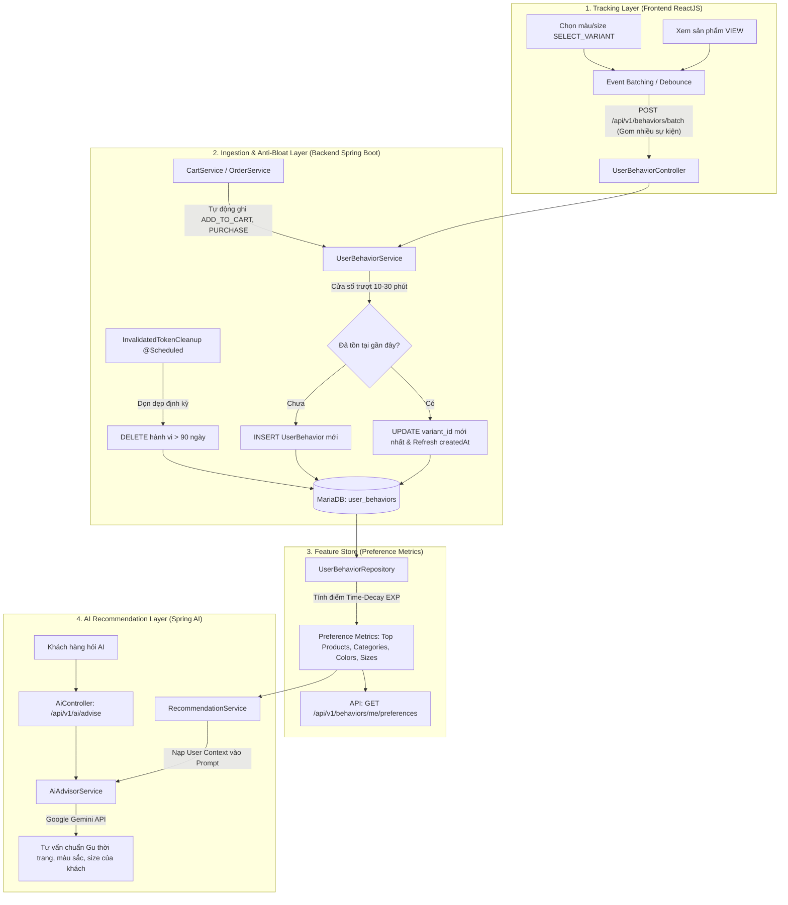

# TÀI LIỆU KIẾN TRÚC INGESTION & FEATURE STORE (THEO DÕI HÀNH VI & SPRING AI)

Tài liệu này mô tả chi tiết tầng **Ingestion & Feature Store (Tiếp nhận dữ liệu hành vi & Lưu giữ chỉ số sở thích)** trong hệ thống tư vấn thời trang thông minh bằng **Spring AI (Google Gemini)** của dự án Fashion Website.

---

## 1. Tổng quan Kiến trúc



---

## 2. Giải quyết triệt để vấn đề Phình to Cơ sở dữ liệu (Anti-Bloat Strategy)

Bảng `user_behaviors` là nơi lưu trữ tần suất cao nhất của toàn hệ thống. Để bảng **không bao giờ bị phình to vô hạn** và duy trì tốc độ truy vấn $O(1)$ đến $O(\log N)$, hệ thống áp dụng cơ chế 2 lớp:

### 2.1. Lớp 1: Cơ chế Gộp hành vi trong Cửa sổ thời gian (Upsert Sliding Window)
- **Hành vi `VIEW` (30 phút)**: Khi khách lướt đi lướt lại cùng một sản phẩm trong vòng 30 phút, hệ thống chỉ giữ **1 bản ghi duy nhất** thay vì tạo hàng chục dòng thừa.
- **Hành vi `SELECT_VARIANT` (10 phút)**:
  - Nếu khách bấm thử màu Trắng - Size S, sau đó đổi sang màu Đen - Size L, hệ thống **cập nhật (`UPDATE`) trực tiếp `variant_id` mới nhất và `createdAt = now()`** trên bản ghi gần nhất.
  - Vừa giúp hồ sơ sở thích ghi nhận chính xác màu/size khách chốt sau cùng, vừa **tiết kiệm 80% số dòng ghi vào database**.

### 2.2. Lớp 2: Tiến trình Dọn dẹp Tự động (Scheduled Cleanup Job - 90 Days)
- Công thức tính điểm hành vi áp dụng hàm suy giảm theo ngày: $\text{Weight} \times e^{-0.05 \times \text{Days}}$.
- Sau **90 ngày**, một hành vi `VIEW` (+1) chỉ còn $1 \times e^{-0.05 \times 90} \approx 0.011$ điểm (gần như bằng 0, không còn giá trị phản ánh xu hướng thời trang hiện tại của khách).
- Hệ thống tích hợp lệnh dọn dẹp vào `InvalidatedTokenCleanup` (`@Scheduled(cron = "0 0 * * * *")`):
  ```java
  LocalDateTime behaviorThreshold = LocalDateTime.now().minusDays(90);
  userBehaviorRepository.deleteAllByCreatedAtBefore(behaviorThreshold);
  ```
- **Kết quả**: Dữ liệu hành vi luôn được duy trì gọn gàng trong vòng 90 ngày gần nhất, dung lượng bảng luôn nằm trong tầm kiểm soát.

---

## 3. Hỗ trợ Thu thập Hàng loạt (Event Batching Ingestion)

Thay vì Frontend phải gửi lẻ tẻ từng HTTP Request mỗi khi khách click, hệ thống cung cấp API Batch Ingestion để gom tối đa 20 sự kiện trong một lần gửi:

- **Endpoint**: `POST /api/v1/behaviors/batch`
- **Quyền**: `ROLE_CUSTOMER`
- **Request Body** (`application/json`):
  ```json
  [
    {
      "productId": 1,
      "variantId": null,
      "type": "VIEW"
    },
    {
      "productId": 1,
      "variantId": 5,
      "type": "SELECT_VARIANT"
    }
  ]
  ```
- **Response (`200 OK`)**:
  ```json
  {
    "code": 200,
    "message": "Đã ghi nhận hàng loạt hành vi thành công",
    "data": null
  }
  ```

---

## 4. Feature Store: Hồ sơ Sở thích Khách hàng (User Preference Metrics)

Từ bảng dữ liệu thô `user_behaviors`, tầng Feature Store tính toán và tổng hợp đa chiều thành hồ sơ sở thích hoàn chỉnh của khách hàng:

### 4.1. Thuật toán Tính toán Ma trận Sở thích (User Preference Score)

Tại Backend, các log hành vi được tổng hợp theo thời gian thực thành bảng chỉ số thuộc tính (Feature Store). Điểm số quan tâm của người dùng $U$ đối với danh mục / phong cách $C$ được tính chính xác theo công thức trọng số:

$$\text{Score}(U, C) = \sum (N_{\text{view}} \times 1) + \sum (N_{\text{dwell}>15s} \times 2) + \sum (N_{\text{select\_size}} \times 3) + \sum (N_{\text{cart}} \times 5) + \sum (N_{\text{purchase}} \times 10) - \sum (N_{\text{remove}} \times 2)$$

#### Giải thích các biến số trong công thức:
- $N_{\text{view}}$: Số lần xem sản phẩm thuộc danh mục $C$ (Trọng số: `+1`).
- $N_{\text{dwell}>15s}$: Số lần dừng lại xem chi tiết sản phẩm trên 15 giây (Dwell Time, Frontend bắn sự kiện `DWELL_15S`, Trọng số: `+2`).
- $N_{\text{select\_size}}$: Số lần bấm chọn màu sắc / kích cỡ biến thể sản phẩm (Frontend bắn sự kiện `SELECT_VARIANT`, Trọng số: `+3`).
- $N_{\text{cart}}$: Số lần thêm vào giỏ hàng (`ADD_TO_CART`, Backend tự ghi, Trọng số: `+5`).
- $N_{\text{purchase}}$: Số lần đặt hàng thành công (`PURCHASE`, Backend tự ghi, Trọng số: `+10`).
- $N_{\text{remove}}$: Số lần xóa khỏi giỏ hàng (`REMOVE_FROM_CART`, Backend tự ghi, Trọng số: `-2`).

---

### 4.2. API & Service cho Tầng 3 (AI / Recommender Engine / Frontend)

Tầng 3 có thể gọi trực tiếp Bean Java qua hàm:
```java
userPreferenceService.getUserScores(userId);
```
hoặc gọi qua REST API Endpoint:

#### 1) Cho khách hàng đang đăng nhập (Frontend gọi)
- **Endpoint**: `GET /api/v1/user-preferences/me/scores`
- **Quyền**: `ROLE_CUSTOMER`
- **Response (`200 OK`)**:
  ```json
  {
    "code": 200,
    "message": "Lấy ma trận điểm sở thích thành công",
    "data": {
      "userId": 5,
      "categoryScores": [
        {
          "categoryId": 2,
          "categoryName": "Áo Sơ Mi",
          "viewCount": 6,
          "dwellCount": 3,
          "selectSizeCount": 4,
          "cartCount": 2,
          "score": 34.0
        },
        {
          "categoryId": 1,
          "categoryName": "Áo Thun",
          "viewCount": 4,
          "dwellCount": 1,
          "selectSizeCount": 2,
          "cartCount": 0,
          "score": 12.0
        }
      ],
      "totalScore": 46.0
    }
  }
  ```

#### 2) Cho Tầng 3 / Service / Admin gọi theo `userId` bất kỳ
- **Endpoint**: `GET /api/v1/user-preferences/{userId}/scores`
- **Quyền**: `ROLE_ADMIN`, `ROLE_STAFF` (hoặc gọi nội bộ Java qua `userPreferenceService.getUserScores(userId)`)

---

### 4.3. API Lấy Hồ sơ Đa chiều (Top Sản phẩm, Danh mục, Màu sắc, Kích cỡ)
- **Endpoint**: `GET /api/v1/behaviors/me/preferences`
- **Quyền**: `ROLE_CUSTOMER`
- **Response (`200 OK`)**:
  ```json
  {
    "code": 200,
    "message": "Hồ sơ sở thích khách hàng (Feature Store)",
    "data": {
      "topProducts": [
        { "productId": 1, "score": 14.85 },
        { "productId": 4, "score": 8.21 }
      ],
      "topCategories": [
        { "categoryId": 2, "categoryName": "Áo Sơ Mi", "score": 18.52 },
        { "categoryId": 1, "categoryName": "Áo Thun", "score": 9.40 }
      ],
      "topColors": ["Đen", "Trắng", "Xanh Navy"],
      "topSizes": ["L", "XL"]
    }
  }
  ```

---

## 5. Tích hợp trực tiếp vào Trợ lý AI (Spring AI & Google Gemini)

Tại [`AiAdvisorService.java`](file:///e:/backup/fashion-website/src/main/java/iuh/fit/fashionwebsite/service/ai/AiAdvisorService.java) và [`AiController.java`](file:///e:/backup/fashion-website/src/main/java/iuh/fit/fashionwebsite/controller/ai/AiController.java):

1. Khi khách hàng gọi API hỏi AI (`POST /api/v1/ai/advise` hoặc `POST /api/v1/ai/advise-stream`):
   - Hệ thống tự động lấy `userId` của khách đang đăng nhập qua `AppUtil.getIdCurrentUser()` trong `0ms`.
   - `RecommendationService.buildUserContext(userId)` tự động trích xuất hồ sơ sở thích từ Feature Store để tạo ngữ cảnh cá nhân hóa:
     ```text
     Thông tin sở thích khách hàng:
     - Sản phẩm quan tâm gần đây: Áo Sơ Mi Oxford Trắng, Quần Tây Nam Slimfit
     - Danh mục ưa thích: Áo Sơ Mi, Quần Tây
     - Màu sắc thường chọn: Trắng, Đen
     - Kích cỡ thường chọn: L

     Câu hỏi của khách: Tư vấn cho tôi một set đồ đi làm công sở lịch sự?
     ```
2. Nếu khách chưa đăng nhập (`userId == null`), AI sẽ đóng vai trò tư vấn viên chung mà không bị lỗi.

---

## 6. Danh mục API Endpoints hoàn chỉnh

| Method | Endpoint | Quyền | Mô tả |
| :--- | :--- | :---: | :--- |
| `POST` | `/api/v1/behaviors` | `CUSTOMER` | Ghi nhận 1 hành vi đơn lẻ (`VIEW`, `DWELL_15S` hoặc `SELECT_VARIANT`). |
| `POST` | `/api/v1/behaviors/batch` | `CUSTOMER` | Ghi nhận hàng loạt hành vi (Event Batching, tối đa 20 sự kiện). |
| `GET` | `/api/v1/behaviors/me/top-products` | `CUSTOMER` | Lấy danh sách ID sản phẩm kèm điểm số giảm dần theo thời gian. |
| `GET` | `/api/v1/user-preferences/me/scores` | `CUSTOMER` | **Ma trận sở thích**: Lấy điểm $\text{Score}(U, C)$ theo danh mục của user hiện tại. |
| `GET` | `/api/v1/user-preferences/{userId}/scores` | `ADMIN`, `STAFF` | **Tầng 3 / Service**: Lấy điểm $\text{Score}(U, C)$ theo `userId` bất kỳ. |
| `GET` | `/api/v1/behaviors/me/preferences` | `CUSTOMER` | **Feature Store**: Lấy hồ sơ sở thích (Top SP, Danh mục, Màu sắc, Size). |
| `POST` | `/api/v1/ai/advise` | Public / Logged-in | Tư vấn thời trang bằng Spring AI (tự động cá nhân hóa theo hồ sơ khách). |
| `POST` | `/api/v1/ai/advise-stream` | Public / Logged-in | Tư vấn dạng Server-Sent Events (SSE Flux streaming). |

---

## 7. Hiện thực hóa ở Phía Frontend (Frontend Implementation & Verification)

Toàn bộ các cập nhật tương ứng đã được triển khai hoàn chỉnh trong mã nguồn Frontend:

1. **`src/types/behavior.ts`**:
   - Mở rộng `BehaviorType = 'VIEW' | 'SELECT_VARIANT' | 'DWELL_15S'`.
   - Bổ sung cấu trúc dữ liệu `CategoryPreferenceScore` và `UserPreferenceScoreResponse`.
2. **`src/pages/ProductDetailPage.tsx`**:
   - Bắn sự kiện `VIEW` ngay khi khách vào xem chi tiết sản phẩm.
   - Hẹn giờ `15000ms`: nếu khách vẫn đang lưu lại đọc trang, tự động gửi `DWELL_15S` (+2 điểm vào Feature Store).
   - Tự động hủy timer (`clearTimeout`) nếu khách chuyển trang trước 15 giây.
3. **`src/services/behaviorService.ts`**:
   - Bắn đơn lẻ: `trackBehavior(payload)` qua `POST /behaviors`.
   - Bắn hàng loạt: `trackBehaviorBatch(requests)` qua `POST /behaviors/batch`.
   - Hàng đợi Event Batching: `queueBehavior(request)` tự động gom và gửi sau 1.5s hoặc khi đạt 10 sự kiện.
   - Lấy ma trận điểm: `getMyPreferenceScores()` qua `GET /user-preferences/me/scores`.
   - Lấy hồ sơ sở thích đa chiều: `getMyPreferences()` qua `GET /behaviors/me/preferences`.
4. **`src/components/ai/AiAdvisorWidget.tsx` & `src/services/aiService.ts`**:
   - Widget nổi "AI Stylist" hỗ trợ khách hàng trò chuyện với Google Gemini.
   - Tự động truyền Token đăng nhập để Backend nạp ma trận sở thích cá nhân hóa.
5. **`src/components/profile/PreferenceMatrixTab.tsx`**:
   - Trực quan hóa ma trận điểm sở thích tại `/account/preferences`, hiển thị bảng chi tiết các lượt View, Dwell >15s, Chọn size, Giỏ hàng và thanh % tỷ lệ quan tâm của từng danh mục.


